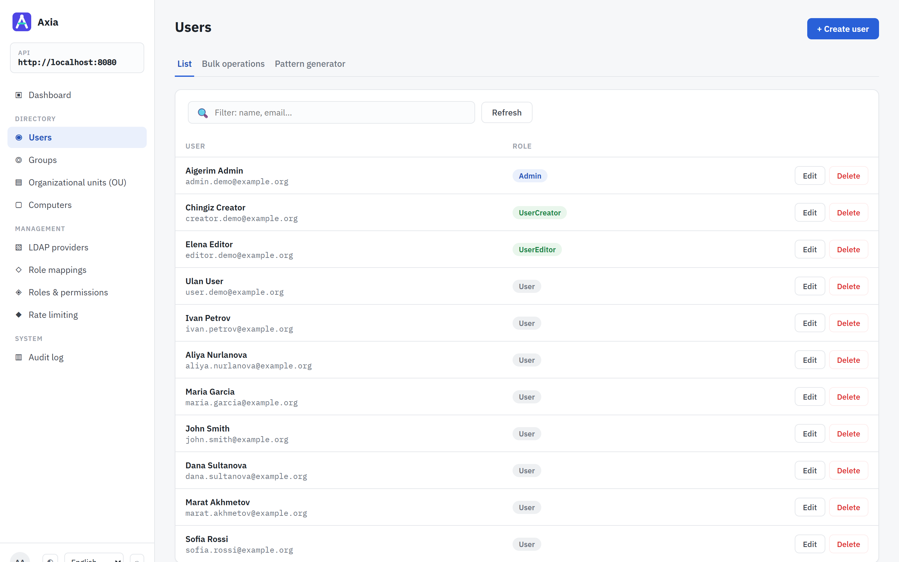
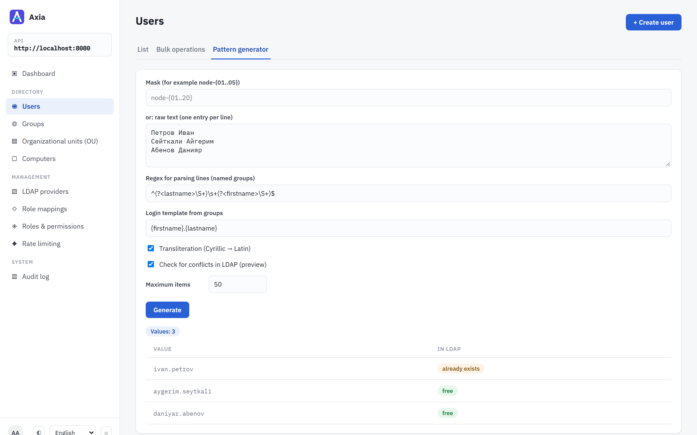
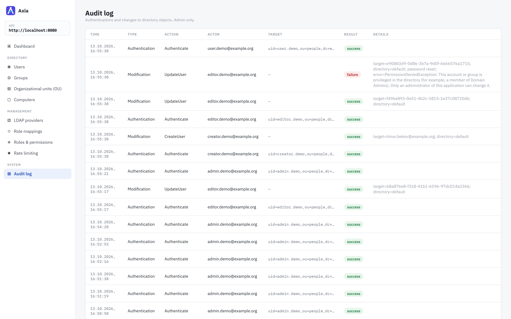
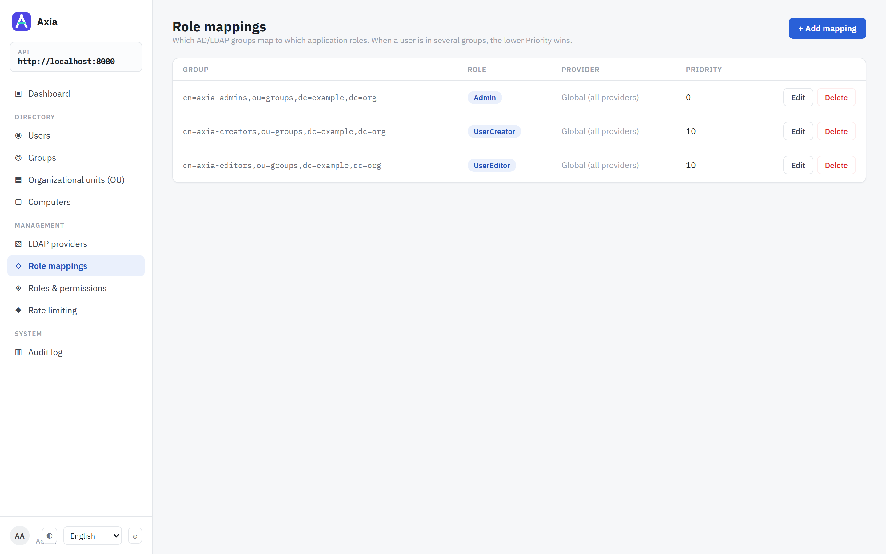
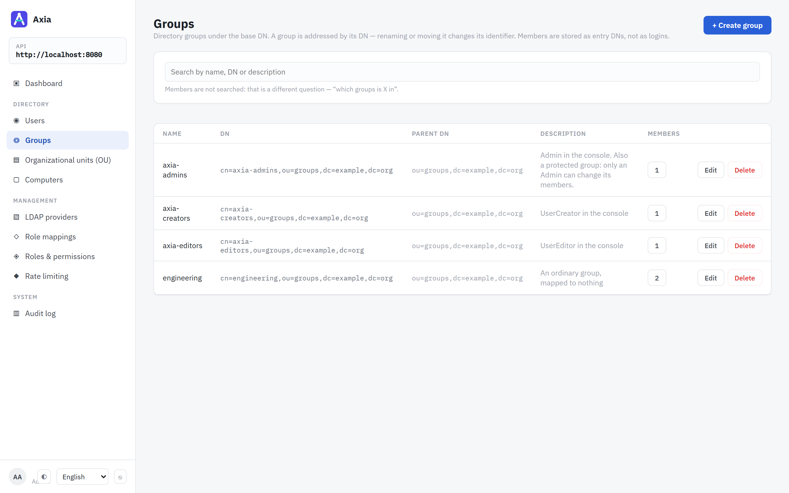

# Nelsar.Axia — open-source web console and REST API for Active Directory and LDAP

**Nelsar.Axia** is a self-hosted web interface and REST API for managing **Active Directory**,
**OpenLDAP** and other LDAP directories from the browser: users, groups, organizational units (OUs)
and computer accounts, across several directories from one instance — with role-based access,
an audit log and bulk user provisioning.

Built on .NET 10 (ASP.NET Core) with a React/TypeScript console. Licensed under Apache 2.0.

[Try it in five minutes](#try-it-in-five-minutes){: .btn .btn-primary .mr-2 }
[Read the documentation](README.md){: .btn .mr-2 }
[Source on GitHub](https://github.com/Nelsar/Axia){: .btn }



## Who it is for

- **IT administrators** who want to hand routine directory work — creating accounts, resetting
  attributes, adding people to groups — to helpdesk or HR staff through a browser, without giving
  them RSAT, a domain-joined Windows machine or a direct LDAP client.
- **Teams running OpenLDAP or a mix of AD and LDAP** who want one console and one API for all of
  their directories.
- **Developers automating identity lifecycle** — onboarding, offboarding, bulk account creation —
  who would rather call a documented REST API (OpenAPI/Swagger) than script LDAP by hand.

## What it does

- **Users** — search, read, create, update, delete; raw directory attributes on demand; bulk
  operations; a pattern generator for bulk account names with transliteration and LDAP conflict
  preview. See [Features](features.md).
- **Groups, organizational units, computer accounts** — full CRUD against the directory tree.
- **Several directories at once** — Active Directory and OpenLDAP side by side, over LDAPS or
  StartTLS, with failover hosts. See [Directories](directories.md).
- **Role mappings** — directory groups map to application roles, globally or per directory, and
  nobody may act on an account that can do more than they can. See
  [Access control](access-control.md).
- **Audit log** — every sign-in, and every attempt to change a directory or the application's
  settings, permitted or refused, with who made it.
- **REST API** — everything the console does, documented and versioned. See [REST API](api.md).
- **Nine interface languages**, including Arabic and Hebrew with a mirrored layout.

| | |
| --- | --- |
|  |  |
| **Pattern generator** — names transliterated into logins, each checked against the directory. | **Audit log** — changes and refused attempts, with who made them. |
|  |  |
| **Role mappings** — which directory group grants which role. | **Groups** — the directory's groups and their members. |

## How it compares

| | Nelsar.Axia | ADUC / RSAT | phpLDAPadmin | Apache Directory Studio |
| --- | --- | --- | --- | --- |
| Runs in a browser | yes | no — Windows desktop | yes | no — desktop |
| REST API for automation | yes | no (PowerShell) | no | no |
| Active Directory and OpenLDAP | both | AD only | both | both |
| Several directories in one instance | yes | one domain at a time | yes | yes |
| Permissions mapped from directory groups | yes | AD delegation | no — the bind account's rights | no |
| Audit log of changes | yes | Windows event log | no | no |
| Bulk creation with name patterns | yes | no — csvde or PowerShell | LDIF import | LDIF import |
| LDAPS / StartTLS to the directory | yes — LDAPS by default | yes | yes | yes |

## Try it in five minutes

The API, the console and an OpenLDAP with demo accounts, in Docker. It needs Docker with
Compose v2 and nothing else.

```bash
git clone https://github.com/Nelsar/Axia.git
cd Axia
docker compose up --build
```

When the API logs `Now listening on`, open <http://localhost:8080> and sign in as `admin.demo`
with the password `Axia-Demo-1`. The other demo accounts, and the two ways to run it against your
own directory, are in [Installation](installation.md). Before putting it in front of real users,
read [Production deployment](production.md) and the
[known limitations](https://github.com/Nelsar/Axia/blob/main/SECURITY.md#known-limitations).
